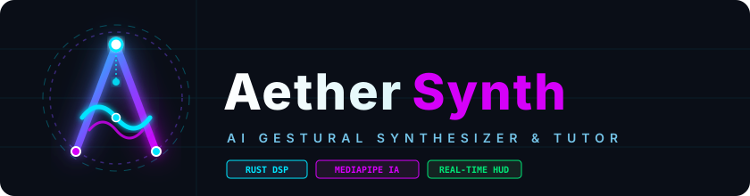

<p align="center">
  
</p>

# AetherSynth

> **Instrumento Musical de Sinais de Palco, Loop Session & IA Harmônica em Tempo Real**
> Projeto para a disciplina de **Tópicos Avançados (IA ou Robótica)** — Curso TADS.

---

## Visão Geral

O **AetherSynth** transforma uma webcam comum em um sintetizador gestual de baixíssima latência orientado por **sinais musicais de palco**, **Loop Session** e **Inteligência Artificial consolidada** — com uma interface estilo jogo 100% operável via **cliques do mouse** (sem precisar decorar atalhos de teclado).

---

## Onde entra a Inteligência Artificial?

1. **Rede Neural MLP (`30 -> 64 -> 32 -> 8`) Invariante à Rotação 3D (`vision_ai/gestures.py`)**:
   - Extrai 30 atributos geométricos 3D (15 cossenos articulares, distâncias ponta-pulso, ponta-MCP e relações interdigitais normalizadas pela palma).
   - Reconhece os **7 sinais musicais de palco** (`Dó`, `Ré`, `Mi`, `Fá`, `Sol`, `Lá`, `Si`) + `Punho` (silêncio) via multiplicação matricial direta em NumPy (~`0,01 ms` por inferência), sem desvios `if/elif` interceptando o modelo.
   - Em um segundo estágio, o vetor direcional da mão define a qualidade/acidente: **para cima (`↑`) = Maior**, **para baixo (`↓`) = Menor**, **direita (`→`) = Sustenido (`#`)** e **esquerda (`←`) = Bemol (`b`)**.
   - **Calibração Ao Vivo (`CALIBRAR IA`)**: grave amostras da sua própria mão na tela e retreine a MLP em segundos.
2. **IA Detectora de Tom e Escala (`vision_ai/harmony_ai.py`)**:
   - Analisa os acordes gravados no Loop Session com perfis tonais de **Krumhansl-Kessler + verossimilhança diatônica Bayesiana** nas 24 tonalidades.
   - Trava automaticamente os **8 pads melódicos** na escala diatônica do tom vencedor (eliminando notas fora do tom) e destaca as notas da tríade do acorde que está soando no compasso atual.
3. **Pulso Rítmico Cinemático & Filtro 1€ (`vision_ai/tracker.py`, `vision_ai/rhythm.py`)**:
   - Captura assíncrona (`ThreadedCamera` com `BUFFERSIZE=1`) + suavização **1-Euro Filter** sem lag.
   - A **mão esquerda** controla o *Cutoff* (abertura), *Pitch Bend* isolado para melodia e detecta **gestos pulsantes verticais** no ar para ajustar o **BPM** do loop em tempo real (*time-stretch* mantendo a afinação).

---

## Arquitetura de Baixa Latência (Rust Lock-Free + Python Vision)

```
 Webcam (Thread MJPG BUFFERSIZE=1) ──> MediaPipe + 1-Euro Filter ──> MLP (0.01ms) + Harmony AI
                                                                              │
                                                                 UDP 127.0.0.1:8765
                                                                              ▼
 Alto-Falantes <── cpal Fixed(256) <── PolySynth (16 vozes) + LoopEngine <── mpsc + Atomics
```

- **Zero `Mutex` no callback de áudio (`audio_engine/src/main.rs`)**: parâmetros contínuos trafegam via `AtomicU32`/`AtomicU8` e eventos discretos via canal `mpsc`.
- **Looper `sample-accurate` (`audio_engine/src/looper.rs`)**: quantiza bases gravadas proporcionalmente em múltiplos de 4 batidas e suporta *overdub* melódico sobre a harmonia.

---

## Como Executar

```bash
cd /home/bernardo/Projetos/gestures-music-ai
./run.sh
```

O programa abre no **Menu Principal** (antes mesmo de ligar a câmera) com botões clicáveis para:
- **Iniciar Loop Session** (gravar base de acordes, travar o tom e improvisar melodia por cima)
- **Modo Desafio** (praticar progressões populares com pontuação e feedback adaptativo da IA)
- **Calibrar IA** (retreinar a Rede Neural com a sua mão)
- **Como Jogar & Timbre** (guia visual de gestos e seleção de forma de onda)
